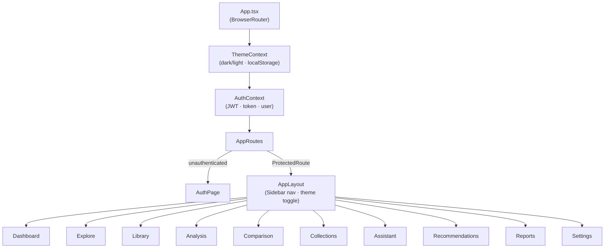
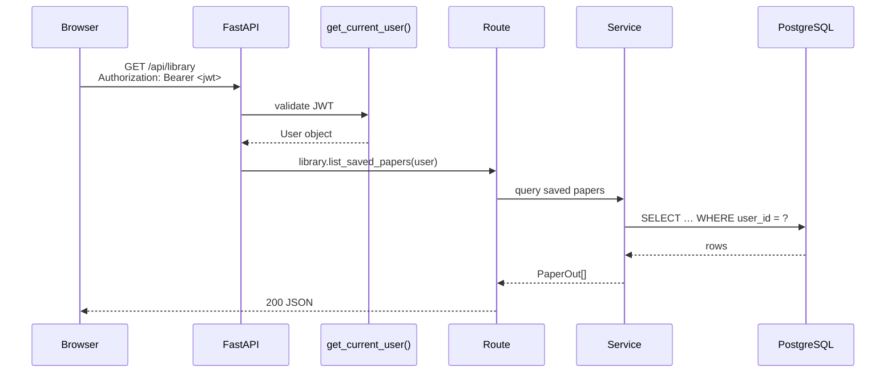
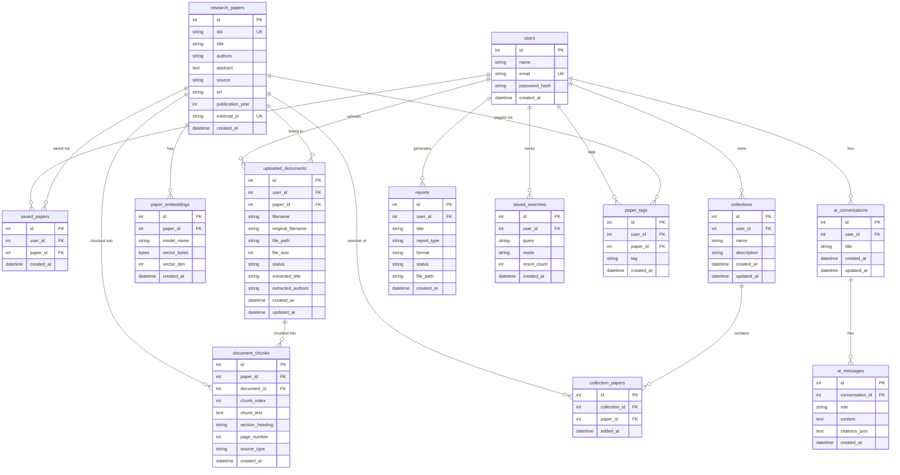
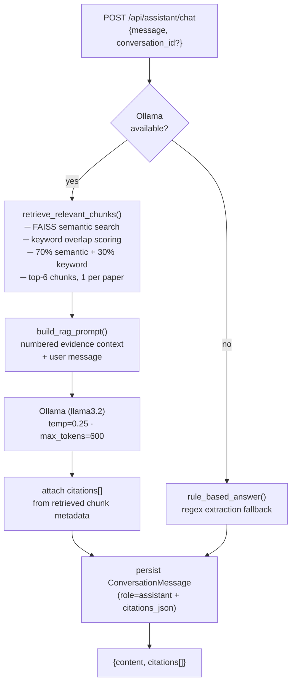
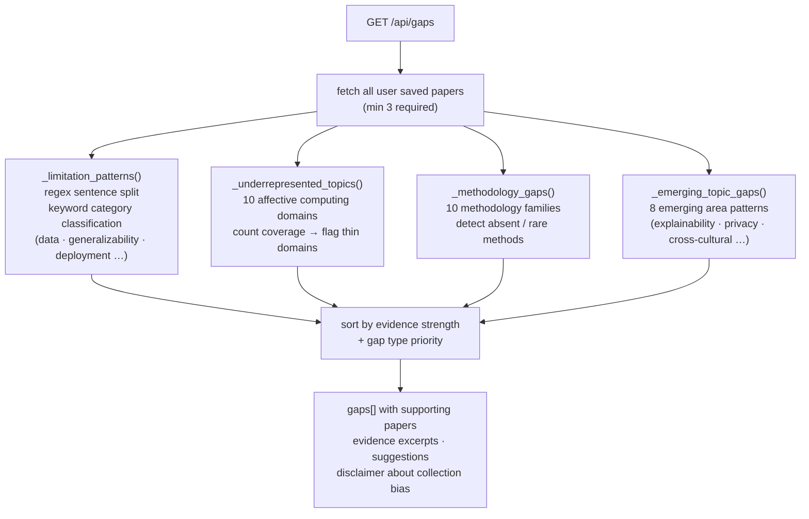
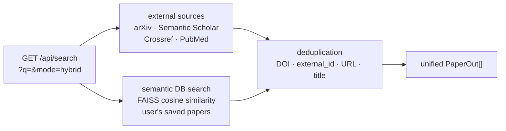

# ARIS — System Architecture

> **Affective Research Intelligence System** · v1.0 · Full-Stack Architecture Reference

---

## Table of Contents

1. [High-Level Overview](#1-high-level-overview)
2. [Frontend Architecture](#2-frontend-architecture)
3. [Backend Architecture](#3-backend-architecture)
4. [Database Design](#4-database-design)
5. [AI / ML Pipeline](#5-ai--ml-pipeline)
6. [Key Data Flows](#6-key-data-flows)
7. [Security Model](#7-security-model)
8. [Technology Stack](#8-technology-stack)

---

## 1. High-Level Overview

ARIS is a three-tier web application: a React SPA frontend, a FastAPI REST backend, and a PostgreSQL database. AI inference runs locally via Ollama; vector search uses an in-memory FAISS index rebuilt from the database on demand.

```
┌──────────────────────────────────────────────────────────────────────┐
│                        Browser (React SPA)                           │
│  Vite · TypeScript · React Router v7 · Recharts · Lucide React       │
│  10 pages · AuthContext · ThemeContext · REST via fetch               │
└───────────────────────────────┬──────────────────────────────────────┘
                                │  HTTP REST  (localhost:5173 → :8001)
                                │  Bearer JWT in Authorization header
┌───────────────────────────────▼──────────────────────────────────────┐
│                      FastAPI Backend  (:8001)                         │
│  Python 3.12 · SQLAlchemy 2 ORM · Pydantic v2 · Alembic              │
│  17 route modules · JWT deps · CORSMiddleware · BackgroundTasks       │
│                                                                       │
│  ┌─────────────────┐  ┌───────────────────┐  ┌───────────────────┐  │
│  │ Academic Search │  │ Document Intel    │  │  AI / ML Layer    │  │
│  │ arXiv           │  │ PyMuPDF extract   │  │ all-MiniLM-L6-v2  │  │
│  │ Semantic Scholar│  │ Section parsing   │  │ FAISS IndexFlatIP │  │
│  │ Crossref        │  │ Chunk generation  │  │ Ollama llama3.2   │  │
│  │ PubMed          │  │ Embedding queue   │  │ RAG pipeline      │  │
│  └─────────────────┘  └───────────────────┘  └───────────────────┘  │
└───────────────────────────────┬──────────────────────────────────────┘
                                │  SQLAlchemy + psycopg3
┌───────────────────────────────▼──────────────────────────────────────┐
│                     PostgreSQL 16  (:5432)                            │
│  13 tables · FK constraints · UUID file paths · Argon2 hashes        │
└──────────────────────────────────────────────────────────────────────┘
          ▲                            ▲
          │ httpx async                │ subprocess / REST
┌─────────┴──────────┐      ┌─────────┴──────────────┐
│  4 Academic APIs   │      │  Ollama  (:11434)        │
│  (external, free)  │      │  llama3.2 · local CPU    │
└────────────────────┘      └────────────────────────┘
```

---

## 2. Frontend Architecture

### 2.1 Page Map

```
/auth          AuthPage          ← Register + Login forms
/dashboard     DashboardPage     ← Stats, insights, evidence brief
/explore       ExplorePage       ← Multi-source search + saved searches
/library       LibraryPage       ← Saved papers, tags, PDF preview, doc search
/analysis      AnalysisPage      ← Recharts analytics + gap analysis cards
/comparison    ComparisonPage    ← Pairwise semantic similarity
/collections   CollectionsPage   ← Collections CRUD + analysis tab
/assistant     AssistantPage     ← RAG chat + conversation history sidebar
/recommendations RecommendationsPage ← Jaccard + embedding recommendations
/reports       ReportsPage       ← Generate + download PDF/DOCX/CSV/JSON/BibTeX
/settings      SettingsPage      ← Change password + theme toggle
```

### 2.2 Component Tree



### 2.3 State Management

| State | Location | Persistence |
|---|---|---|
| Auth token + user | `AuthContext` | `localStorage` |
| Theme (dark/light) | `ThemeContext` | `localStorage` |
| CSS custom properties | `index.css` variables | DOM |
| Server data | Local `useState` per page | Memory (re-fetched on mount) |

### 2.4 API Client

All HTTP calls go through [`src/services/api.ts`](../frontend/src/services/api.ts). It reads `VITE_API_URL` (default `http://localhost:8001`) and injects the JWT `Authorization: Bearer <token>` header on every authenticated request.

---

## 3. Backend Architecture

### 3.1 Layer Structure

```
app/
├── main.py               ← FastAPI app, CORS, router registration, startup
├── core/
│   └── config.py         ← Pydantic Settings (DATABASE_URL, JWT_SECRET, …)
├── db/
│   ├── base.py           ← DeclarativeBase
│   └── session.py        ← SQLAlchemy engine + SessionLocal
├── api/
│   ├── deps.py           ← get_db(), get_current_user() JWT dependency
│   └── routes/           ← 17 route modules (one per domain)
├── models/               ← SQLAlchemy ORM models (9 files, 13 tables)
├── schemas/              ← Pydantic request/response schemas
├── services/             ← Business logic (auth, embedding, RAG, gaps, …)
└── integrations/         ← 4 academic API adapters + utils
```

### 3.2 Request Lifecycle



### 3.3 Route Modules

| Module | Prefix | Key endpoints |
|---|---|---|
| `auth.py` | `/api/auth` | register, login, me, change-password, request-reset, confirm-reset |
| `search.py` | `/api/search` | multi-source + semantic hybrid search |
| `library.py` | `/api/library` | list, save-paper, remove |
| `dashboard.py` | `/api/dashboard` | stats |
| `insights.py` | `/api/insights` | research insights |
| `briefs.py` | `/api/brief` | evidence brief |
| `comparison.py` | `/api/compare` | pairwise semantic comparison |
| `analytics.py` | `/api/analytics` | charts data (filterable) |
| `gaps.py` | `/api/gaps` | gap engine + rebuild-index |
| `assistant.py` | `/api/assistant` | status, chat, embed-library |
| `conversations.py` | `/api/conversations` | list, get, delete |
| `documents.py` | `/api/documents` | upload, list, search, delete, serve |
| `collections.py` | `/api/collections` | CRUD + papers + analyze |
| `saved_searches.py` | `/api/saved-searches` | list, save, delete |
| `tags.py` | `/api/tags` | add, remove, list, by-paper, by-tag |
| `recommendations.py` | `/api/recommendations` | recommended papers |
| `reports.py` | `/api/reports` | generate (5 formats), list, download |

### 3.4 Background Tasks

Two operations run as FastAPI `BackgroundTasks` (non-blocking):

| Trigger | Task |
|---|---|
| `POST /api/library/save-paper` | Generate embedding → store `PaperEmbedding` + `DocumentChunk` from abstract |
| `POST /api/documents/upload` | PyMuPDF text extraction → section parsing → store `DocumentChunk`s |

---

## 4. Database Design

### 4.1 Entity-Relationship Diagram



### 4.2 Key Constraints

| Table | Constraint |
|---|---|
| `users.email` | UNIQUE |
| `research_papers.doi` | UNIQUE (nullable) |
| `research_papers.external_id` | UNIQUE (nullable) |
| `saved_papers (user_id, paper_id)` | UNIQUE composite |
| `paper_embeddings.paper_id` | UNIQUE — one vector per paper |
| `collection_papers (collection_id, paper_id)` | UNIQUE — no duplicates |
| `paper_tags (user_id, paper_id, tag)` | UNIQUE — idempotent tag add |
| All FK relationships | `ON DELETE CASCADE` or `SET NULL` |

### 4.3 Alembic Migrations

```
alembic/versions/
├── 0001_initial_schema.py      ← users, research_papers, saved_papers
└── 0002_add_all_milestone_tables.py  ← all remaining 10 tables
```

---

## 5. AI / ML Pipeline

### 5.1 Embedding Pipeline

```mermaid
flowchart LR
    SavePaper["POST /api/library/save-paper"] -->|BackgroundTask| EmbedService["embedding_service.py"]
    EmbedService -->|"title + abstract"| Model["all-MiniLM-L6-v2\n384-dim · Apache 2.0"]
    Model -->|float32 vector| Norm["L2 normalize"]
    Norm -->|numpy .tobytes()| DB["paper_embeddings\n(vector_bytes · vector_dim)"]
    DB -->|on next search| FAISS["FAISS IndexFlatIP\n(in-memory rebuild)"]
```

**Model:** `sentence-transformers/all-MiniLM-L6-v2`  
**Dimensions:** 384  
**Index:** `FAISS IndexFlatIP` — inner product on L2-normalized vectors = cosine similarity  
**Persistence:** Raw float32 bytes in PostgreSQL; index rebuilt from DB on first search or explicit rebuild request.

### 5.2 RAG Pipeline



**Chunking strategy:** 400-character chunks with 80-character overlap from paper abstracts and extracted PDF text.  
**Retrieval:** FAISS top-20 semantic candidates → hybrid re-score → best chunk per paper → top-6 passed to LLM.  
**No hallucination:** Citations reference only the retrieved chunk's actual paper metadata — no fabricated page numbers.

### 5.3 Research Gap Engine



**Evidence strength tiers:** Weak (<2 papers) · Emerging (2–4) · Moderate (5–9) · Strong (10+)

### 5.4 Hybrid Search



---

## 6. Key Data Flows

### 6.1 Save Paper Flow

```
User clicks "Save" in ExplorePage
  → POST /api/library/save-paper  {title, authors, abstract, source, …}
      → Dedup check (DOI / external_id / URL / title normalization)
      → UPSERT ResearchPaper record
      → INSERT SavedPaper (user_id, paper_id)
      → BackgroundTask: generate_embedding()
          → all-MiniLM-L6-v2 encode(title + abstract)
          → L2 normalize → tobytes()
          → UPSERT PaperEmbedding
          → INSERT DocumentChunk (source_type=abstract)
          → FAISS index invalidated (rebuilt on next semantic search)
  → 201 {paper_id, message}
```

### 6.2 PDF Upload Flow

```
User uploads PDF in LibraryPage
  → POST /api/documents/upload  (multipart/form-data)
      → Validate: extension .pdf, magic bytes %PDF-
      → Size check ≤ 50 MB
      → Save file to storage/uploads/<uuid>.pdf
      → INSERT UploadedDocument (status=pending)
      → BackgroundTask: extract_pdf_text()
          → status = processing
          → PyMuPDF: page-by-page text extraction
          → section heading detection (regex)
          → chunk_text (400 chars, 80 overlap)
          → INSERT DocumentChunk[] (source_type=pdf)
          → status = completed  (or failed on error)
  → 201 {document_id, status}
```

### 6.3 Report Generation Flow

```
User clicks Generate in ReportsPage
  → POST /api/reports/generate  {title, format, paper_ids}
      → fetch saved papers for user
      → switch format:
          pdf    → ReportLab canvas → write bytes
          docx   → python-docx Document → save
          csv    → Pandas DataFrame → StringIO
          json   → json.dumps()
          bibtex → @article{} template strings
      → save file to storage/reports/<uuid>.<ext>
      → INSERT Report (status=completed, file_path)
  → 200 {report_id, download_url}
```

---

## 7. Security Model

| Concern | Mechanism |
|---|---|
| Password storage | Argon2id via `passlib[argon2]` — never bcrypt/MD5 |
| Session tokens | HS256 JWT · configurable expiry (default 1440 min) |
| Route protection | `get_current_user()` FastAPI dependency on every protected route |
| Data isolation | Every DB query filters `WHERE user_id = current_user.id` |
| File upload safety | Extension check + PDF magic bytes (`%PDF-`) + size cap |
| File paths | Server-generated UUID names — user cannot traverse paths |
| SQL injection | SQLAlchemy ORM parameterized queries only |
| Secrets | `.env` file — never committed (`.gitignore`) |
| CORS | Localhost origins only (`5173`, `5174`) |
| Error responses | Generic messages — no stack traces or internal paths exposed |

---

## 8. Technology Stack

### Frontend

| Library | Version | Role |
|---|---|---|
| React | 19 | UI framework |
| TypeScript | 7 | Type safety |
| Vite | 8 | Dev server + bundler |
| React Router | 7 | Client-side routing |
| Recharts | 3 | Analytics charts |
| Lucide React | 1 | Icon set |

### Backend

| Library | Version | Role |
|---|---|---|
| FastAPI | 0.115+ | Web framework |
| SQLAlchemy | 2 | ORM |
| Pydantic | 2 | Request/response validation |
| Alembic | 1 | Database migrations |
| python-jose | 3 | JWT encode/decode |
| passlib[argon2] | 1.7+ | Password hashing |
| httpx | 0.28+ | Async HTTP client (API calls) |

### AI / ML

| Library | Role |
|---|---|
| sentence-transformers | all-MiniLM-L6-v2 embedding generation |
| faiss-cpu | In-memory vector index |
| PyMuPDF (fitz) | PDF text extraction |
| Ollama | Local LLM inference (llama3.2) |
| ReportLab | PDF report generation |
| python-docx | DOCX report generation |
| Pandas | CSV export |

### Infrastructure

| Component | Version | Role |
|---|---|---|
| PostgreSQL | 16 | Primary database |
| psycopg | 3 | PostgreSQL async driver |
| Python | 3.12 | Runtime |
| Node.js | 20+ | Frontend toolchain |

---

*Architecture document for ARIS v1.0 — Final Year Engineering Major Project.*
